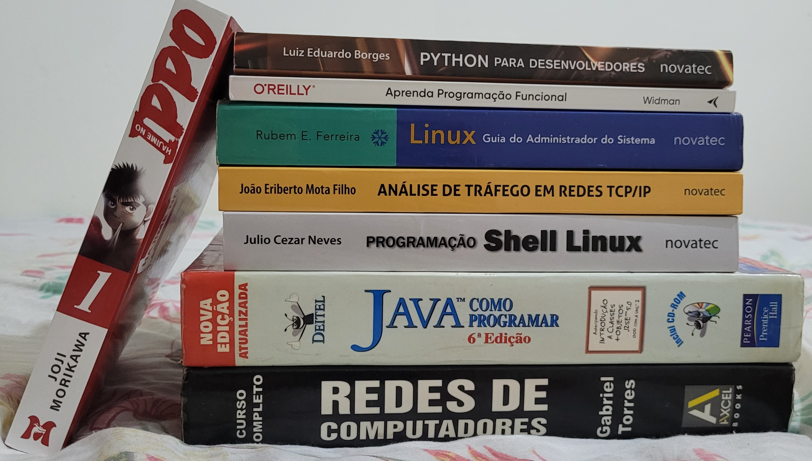

  

  

---

**Hello! My name is** `Carlos G. Baratieri`

> [!IMPORTANT]
> Tenho 23 anos, sou formado em Tecnologia em Segurança da Informação pela FATEC Ourinhos e atualmente curso Engenharia de Computação na UTFPR-CP. Tenho interesse em redes de computadores, DevSecOps, System Design, algoritmos, estruturas de dados, desenvolvimento back-end, teoria do caos, criptografia caótica, algoritmos aleatorizados e otimização combinatória.

> [!NOTE]
> Fui **monitor** da disciplina de **Algoritmos 1** no primeiro semestre de 2025 e, em 2026, fui aprovado em um edital para trabalhar no **Laboratório e Centro de Computação Científica e Tecnológica (CCCT-CP)**. Na Fatec, realizei um estágio com pouca alinhamento de plano trabalhista, mas o principal foi a criação de **desafios (CTFs)/serviços de rede** para a **Semana da Segurança da Informação**.
  
- [Seleção 2025/1 de Estudantes Monitores - UTFPR](https://www.utfpr.edu.br/editais/graduacao-e-educacao-profissional/cornelioprocopio/selecao-2025-1-de-estudantes-monitores-de-atendimento-ao-estudante-mat-e-apoio-ao-docente-map-da-utfpr-do-campus-cornelio-procopio)
- [Laboratório Multiusuário CCCT-CP - UTFPR](https://www.utfpr.edu.br/editais/pesquisa-e-pos-graduacao/laboratorios-multiusuarios/ccct-cp/bolsista_nivel_medio_2025)
- [Título e Orientador do meu TCC (artigo)](https://www.escavador.com/sobre/4047058/christovam-castilho-junior#:~:text=Aluno%3A%20Carlos%20Gabriel%20Baratieri)

> [!TIP]
> Abaixo estão alguns dos livros do meu acervo pessoal (livros físicos).

  <table align="center">
    <tr>
      <td>
        
      </td>
      <td>
        
      </td>
    </tr>
  </table>

---

  <table align="center">
    <tr>
      <th align="center">Category</th>
      <th align="center">Skills</th>
    </tr>
    <tr>
      <td align="center"><b>Programming</b></td>
      <td align="center">
        
        
        
        
        
      </td>
    </tr>
    <tr>
      <td align="center"><b>Markup</b></td>
      <td align="center">
        
        
        
      </td>
    </tr>
    <tr>
      <td align="center"><b>Scripting & Tools</b></td>
      <td align="center">
        
        
        
        
        
        
        
        
      </td>
    </tr>
    <tr>
      <td align="center"><b>Databases</b></td>
      <td align="center">
        
        
      </td>
    </tr>
    <tr>
      <td align="center"><b>OS & Networking</b></td>
      <td align="center">
        
        
        
        
        
        
      </td>
    </tr>
  </table>

---

  

